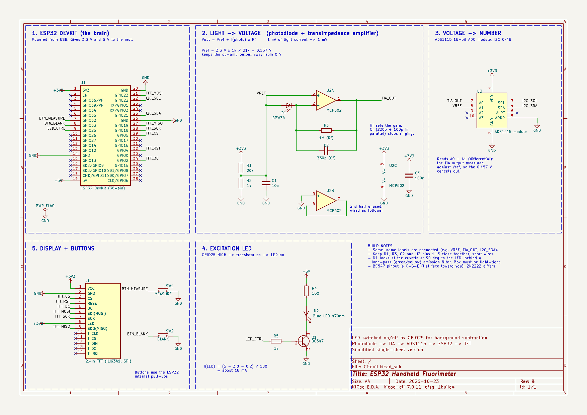
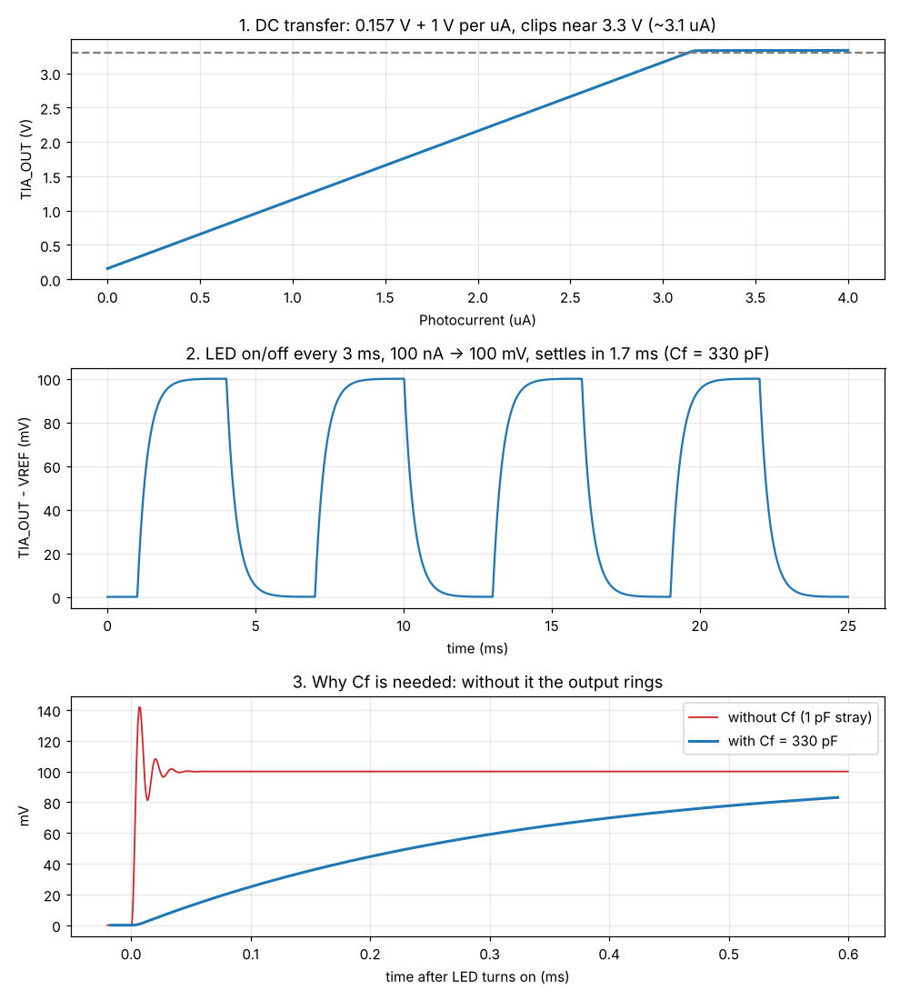

# ESP32 Handheld Fluorimeter

A low-cost, portable fluorimeter built around an ESP32. A blue LED excites the sample, a photodiode picks up the fluorescence, and the ESP32 shows the concentration on a 2.4" TFT.



## How it works

```
Blue LED ──> sample (cuvette) ──> emission filter ──> BPW34 photodiode
                                                          │  nA current
                                                          ▼
                                            MCP602 transimpedance amp (1 MΩ)
                                                          │  1 mV per nA
                                                          ▼
                                              ADS1115 16-bit ADC (I2C)
                                                          │
                                                          ▼
                                                 ESP32 ──> TFT display
```

- The photodiode sits at 90° to the LED so the excitation beam doesn't hit it directly.
- The TIA converts photocurrent to voltage: `Vout = Vref + Iph × Rf`, with Rf = 1 MΩ and Vref = 0.157 V.
- Each reading switches the LED off and on 32 times and averages `(LED on − LED off)`. This cancels room light, dark current and op-amp offset.
- A blank (plain solvent) is subtracted, and a straight-line calibration from known standards converts the signal to concentration.

## Repository structure

```
1_Schematic/          KiCad schematic (Circuit.kicad_sch) and PDF
2_Firmware/           Arduino sketch (fluorimeter/fluorimeter.ino)
3_Simulation/
  LTspice_models/     SPICE netlists of the analog front end
  Outputs/            simulation plots, data (CSV) and summary
docs/
  BOM.md              parts list
  images/             pictures used in this README
```

## Hardware

| Block | Part | Notes |
|---|---|---|
| Controller | ESP32 DevKit (38-pin) | USB powered, supplies 3.3 V and 5 V |
| Detector | Vishay BPW34 photodiode | zero bias, behind a long-pass filter |
| Amplifier | MCP602 (DIP-8) | Rf = 1 MΩ, Cf = 330 pF, Vref from 20k/1k divider |
| ADC | ADS1115 module | differential A0 − A1, ±2.048 V, I2C 0x48 |
| Excitation | Blue LED (~470 nm) | 100 Ω from 5 V, switched by BC547 |
| Display | 2.4" ILI9341 SPI TFT | 320 × 240 |
| Input | 2 push buttons | MEASURE, BLANK |

Full list: [docs/BOM.md](docs/BOM.md)

### ESP32 pin map

| Function | GPIO |
|---|---|
| TFT CS / DC / RST | 5 / 2 / 4 |
| TFT SCK / MOSI / MISO | 18 / 23 / 19 |
| ADS1115 SDA / SCL | 21 / 22 |
| LED control | 25 |
| MEASURE / BLANK buttons | 32 / 33 |

## Firmware

Open `2_Firmware/fluorimeter/fluorimeter.ino` in the Arduino IDE.

- Board: **ESP32 Dev Module**
- Libraries: **Adafruit ADS1X15**, **Adafruit ILI9341**, **Adafruit GFX Library**

Set `RF` to your measured feedback resistor value and `UNITS` to the unit of your standards.

### Screen

| Area | Shows |
|---|---|
| Header | BLANK OK/--, CAL OK/--, SINGLE/CONTINUOUS |
| Big number | concentration (after calibration) or signal in nA |
| Net | fluorescence current (LED on − LED off), nA |
| Noise | ± uncertainty of the reading |
| Dark | background current with LED off, nA |
| Bottom line | status messages (Press MEASURE, Blank stored, SATURATED …) |

### Controls

- **MEASURE**: press for one reading, hold 1 s to toggle continuous mode
- **BLANK**: press with a solvent-only cuvette to store the blank
- **Serial monitor (115200 baud)**: `m`, `blank`, `std <conc>`, `fit`, `clear`

### Calibration

1. Insert plain solvent, press **BLANK**.
2. Insert each standard and type `std 1`, `std 2`, … (its concentration).
3. Type `fit`. The screen now shows concentration.

Calibration is saved in flash and survives power-off.

## Simulation

The analog front end was simulated in SPICE with an MCP602-like op-amp model (100 dB gain, 2.8 MHz GBW, rail-to-rail output). The photodiode is modelled as a current source with 70 pF. The netlists open directly in LTspice, and Microchip's MCP601 model can be swapped in.



| Test | Result |
|---|---|
| DC transfer | 1 V per µA, clips near 3.3 V at ~3.1 µA |
| LED pulse (100 nA) | 100 mV step, settles in 1.7 ms (firmware waits 3 ms) |
| Without Cf | ~42 % overshoot and ringing, which shows why Cf is needed |

## Status

- [x] Schematic
- [x] Firmware (compiles, not yet tested on hardware)
- [x] SPICE simulation of the front end
- [ ] Breadboard build and testing
- [ ] Optics: emission filter, light-tight cuvette holder
- [ ] Calibration with fluorescein standards
- [ ] PCB layout

## Credits

Based on an earlier design by Poojan ([Handheld_Fluorometer_Design](https://github.com/Poojan-84/Handheld_Fluorometer_Design)).

## License

MIT, see [LICENSE](LICENSE).
